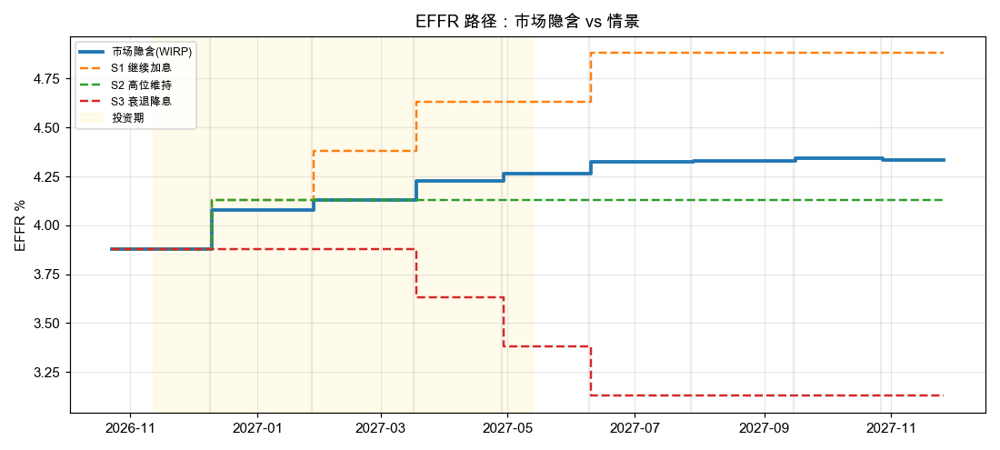
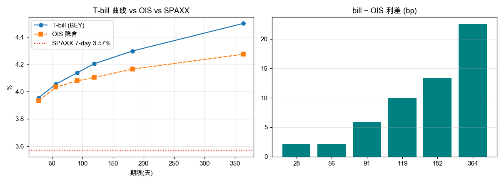
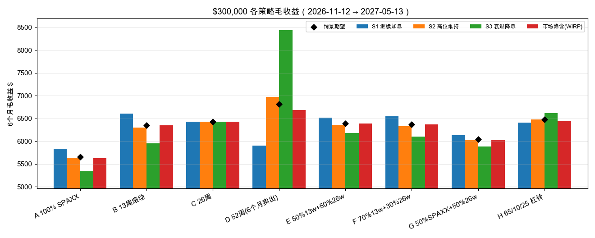
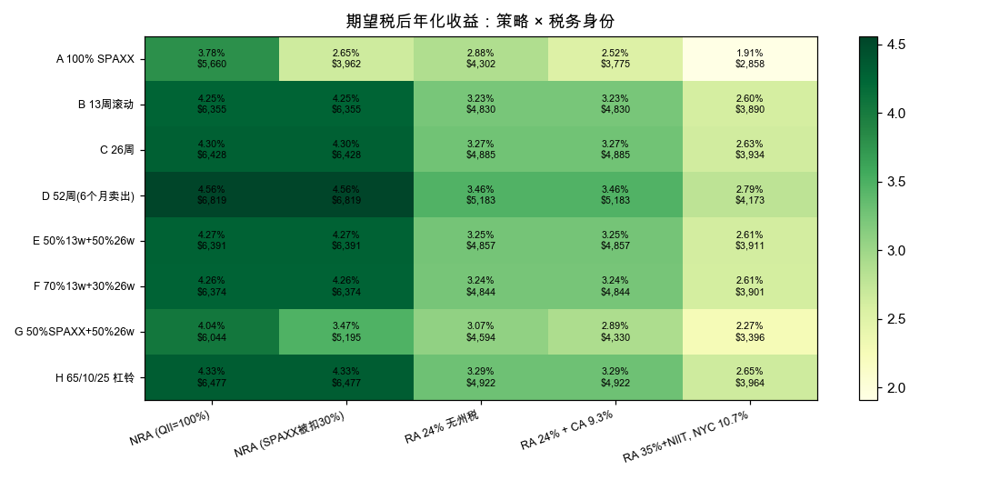
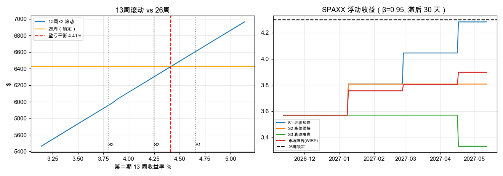
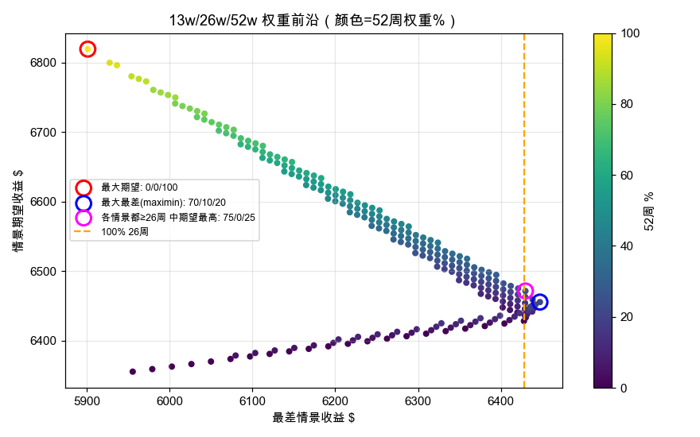
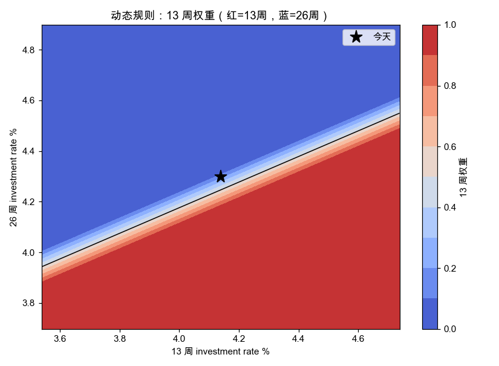
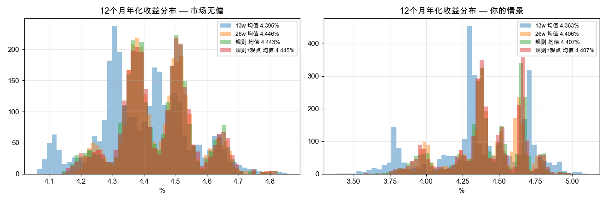

# T-bill vs SPAXX 自动报告（2026-11-08）

> 生成时间 2026-11-08 22:43。所有数字由 notebook 参数计算，不是投资建议。

## 1. 市场输入
* EFFR 3.88%，目标区间上限 4.00%；SPAXX 7-day 3.57%
* T-bill（investment rate）：28天 3.956%，56天 4.055%，91天 4.138%，119天 4.204%，182天 4.298%，364天 4.500%
* 市场（WIRP）在 2027-05-13 前隐含累计 **+40bp**，全程最高 **+46bp**（加息定价）
* bill−OIS 利差：28天 +2bp，56天 +2bp，91天 +6bp，119天 +10bp，182天 +13bp，364天 +23bp

## 2. 关键阈值
* **13 周滚动盈亏平衡**：3 个月后 13 周需 ≥ **4.412%**（当前 4.138%，需 +27bp）
* 52 周隐含 6 个月后 26 周远期：**4.702%**（6 个月后若低于此值，卖出 52 周优于 26 周）

## 3. 策略毛收益（2026-11-12 → 2027-05-13，182 天，$300,000）
|                   |   S1 继续加息 |   S2 高位维持 |   S3 衰退降息 |   期望(情景加权) |   最差情景 |   期望年化% |
|:------------------|--------------:|--------------:|--------------:|-----------------:|-----------:|------------:|
| A 100% SPAXX      |       5835.26 |       5634.35 |       5336.22 |          5659.95 |    5336.22 |        3.78 |
| B 13周滚动        |       6605.76 |       6300.2  |       5955.44 |          6355.43 |    5955.44 |        4.25 |
| C 26周            |       6428.5  |       6428.22 |       6427.81 |          6428.26 |    6427.81 |        4.3  |
| D 52周(6个月卖出) |       5901.21 |       6975.82 |       8440.03 |          6819.33 |    5901.21 |        4.56 |
| E 50%13w+50%26w   |       6516.56 |       6363.64 |       6186.25 |          6390.55 |    6186.25 |        4.27 |
| F 70%13w+30%26w   |       6548.62 |       6334.32 |       6098.85 |          6374.01 |    6098.85 |        4.26 |
| G 50%SPAXX+50%26w |       6131.88 |       6031.29 |       5882.01 |          6044.11 |    5882.01 |        4.04 |
| H 65/10/25 杠铃   |       6411.88 |       6480.39 |       6616.93 |          6476.89 |    6411.88 |        4.33 |

* 期望最高：**D 52周(6个月卖出)**（$6,819）
* 最差情景最好：**C 26周**（最差 $6,428）
* 网格优化：最大期望 0/0/100（13w/26w/52w），
  各情景都 ≥ 26周 中期望最高 **75/0/25**（期望 $6,471）

## 4. 税后期望收益（$）
|                   |   NRA (QII=100%) |   NRA (SPAXX被扣30%) |   RA 24% 无州税 |   RA 24% + CA 9.3% |   RA 35%+NIIT, NYC 10.7% |
|:------------------|-----------------:|---------------------:|----------------:|-------------------:|-------------------------:|
| A 100% SPAXX      |             5660 |                 3962 |            4302 |               3775 |                     2858 |
| B 13周滚动        |             6355 |                 6355 |            4830 |               4830 |                     3890 |
| C 26周            |             6428 |                 6428 |            4885 |               4885 |                     3934 |
| D 52周(6个月卖出) |             6819 |                 6819 |            5183 |               5183 |                     4173 |
| E 50%13w+50%26w   |             6391 |                 6391 |            4857 |               4857 |                     3911 |
| F 70%13w+30%26w   |             6374 |                 6374 |            4844 |               4844 |                     3901 |
| G 50%SPAXX+50%26w |             6044 |                 5195 |            4594 |               4330 |                     3396 |
| H 65/10/25 杠铃   |             6477 |                 6477 |            4922 |               4922 |                     3964 |

## 5. 动态规则今天的输出（税务身份：RA 24% + CA 9.3%）
* 远期/盈亏平衡 F = 4.412%，预期 E = 4.310%，**edge = -10.3bp**
* **建议：13 周 16% / 26 周 84%**
* 52 周期限溢价 +19bp → 建议配置一部分 52 周（用 13 周对冲）
* 推迟 1 周投资需要 26 周收益率上升 ≥ 2.9bp → **不要等，到期即投**

## 6. 蒙特卡洛（3000 条路径，12 个月年化均值 %）
| 世界 | 永远13周 | 永远26周 | 规则 | 规则+观点 |
|---|---|---|---|---|
| 市场无偏 | 4.395 | 4.446 | 4.443 | 4.445 |
| 你的情景 | 4.363 | 4.406 | 4.407 | 4.407 |

## 7. 图表

## 8. 主要假设与风险
* SPAXX 传导 β、滞后天数；bill−OIS 利差保持不变；情景概率为主观设定
* 情景内假设市场在每个时点“看到”该情景剩余路径（完美预见）
* 税务：NRA 身份由 §7701(b) 决定，W-8BEN 不创造身份；SPAXX QII 比例需按 Fidelity 年度税务文件核实
